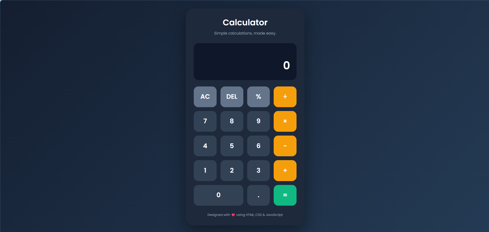
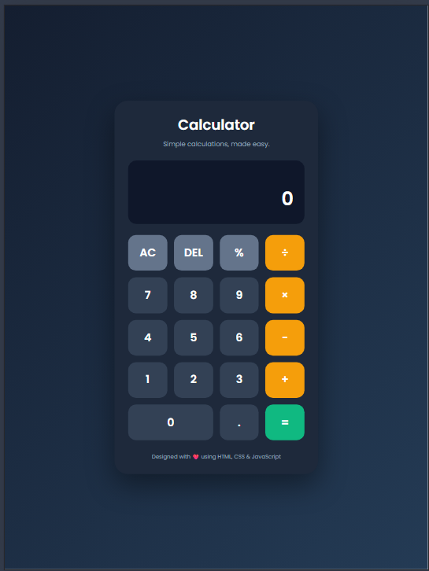
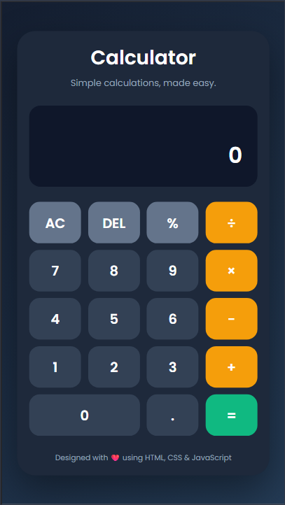

# Modern Calculator

A simple, modern, and responsive calculator built using **HTML, CSS, and JavaScript** as part of my CodeAlpha Frontend Development Internship.

## About the Project

This calculator performs basic arithmetic operations through an easy-to-use interface. It supports both mouse clicks and keyboard input, making calculations simple and convenient.

## Features

- Addition, subtraction, multiplication, and division
- Percentage calculations
- Decimal number support
- Clear (AC) and Delete (DEL) functions
- Keyboard support for quick calculations
- Error handling for division by zero
- Responsive design for desktop, tablet, and mobile screens
- Modern interface with interactive buttons

## Technologies Used

- HTML5
- CSS3
- JavaScript
- Google Fonts (Poppins)
- Visual Studio Code
- Git and GitHub

## Project Structure

```text
CodeAlpha_Calculator/
│
├── index.html
├── style.css
├── script.js
├── Screenshots/
│   ├── desktop-calculator.png
│   ├── tablet-calculator.png
│   └── mobile-calculator.png
│
└── README.md
```

## Screenshots

<table>
  <tr>
    <th>Desktop View</th>
    <th>Tablet View</th>
    <th>Mobile View</th>
  </tr>
  <tr>
    <td></td>
    <td></td>
    <td></td>
  </tr>
</table>

## How to Run the Project

1. Clone or download this repository.
2. Open the project folder in Visual Studio Code.
3. Open `index.html` using the Live Server extension.
4. Start performing calculations.

## Keyboard Controls

| Key | Function |
|---|---|
| 0–9 | Enter numbers |
| +, -, *, / | Arithmetic operations |
| . | Decimal point |
| Enter or = | Calculate result |
| Backspace | Delete last digit |
| Escape | Clear calculator |
| % | Percentage |

## Internship Details

- **Organization:** CodeAlpha
- **Internship:** Frontend Development
- **Task:** Task 2 – Calculator

## Author

**GitHub:** [ritika0117](https://github.com/ritika0117)

---

Created as part of my learning journey in frontend development.