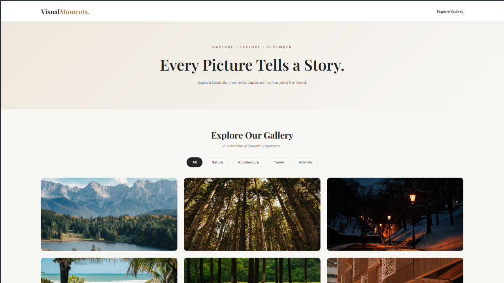
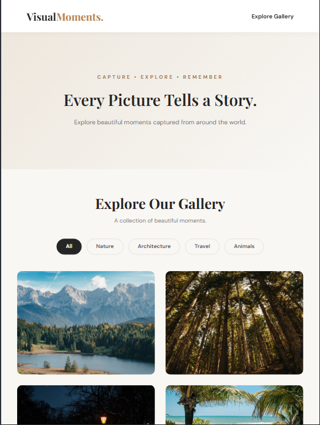
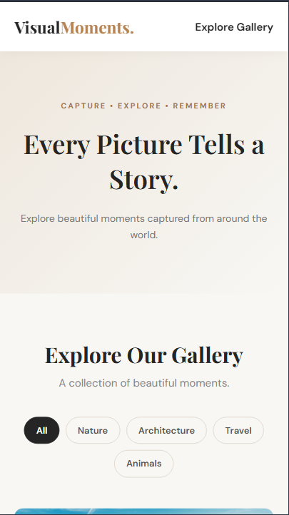

# 🌸 Visual Moments – Image Gallery

A beautiful, modern, and responsive image gallery built using **HTML, CSS, and JavaScript** as part of the **CodeAlpha Frontend Development Internship**.

Visual Moments allows users to explore beautiful photographs across different categories with interactive filtering, smooth hover effects, and an engaging lightbox experience.

---

## ✨ Features

- 📸 Responsive image gallery with 20 images.
- 🗂️ Four image categories: Nature, Architecture, Travel, and Animals.
- 🔍 Interactive category filtering.
- 🖼️ Lightbox preview for viewing images.
- ⏮️ Previous and Next image navigation.
- ⌨️ Keyboard navigation using arrow keys.
- ❌ Close lightbox using the Escape key.
- 🎨 Modern and clean user interface.
- ✨ Smooth hover effects and transitions.
- 📱 Fully responsive design for desktop, tablet, and mobile devices.

---

## 🛠️ Technologies Used

- HTML5
- CSS3
- JavaScript
- Google Fonts
- Visual Studio Code
- Git and GitHub

---

## 📂 Project Structure

```text
CodeAlpha_ImageGallery/
│
├── index.html
├── style.css
├── script.js
│
├── images/
│   ├── nature1.jpg
│   ├── nature2.jpg
│   ├── nature3.jpg
│   ├── nature4.jpg
│   ├── nature5.jpg
│   ├── architecture1.jpg
│   ├── architecture2.jpg
│   ├── architecture3.jpg
│   ├── architecture4.jpg
│   ├── architecture5.jpg
│   ├── travel1.jpg
│   ├── travel2.jpg
│   ├── travel3.jpg
│   ├── travel4.jpg
│   ├── travel5.jpg
│   ├── animals1.jpg
│   ├── animals2.jpg
│   ├── animals3.jpg
│   ├── animals4.jpg
│   └── animals5.jpg
│
├── Screenshots/
│   ├── desktop-gallery.png
│   ├── tablet-gallery.png
│   └── mobile-gallery.png
│
└── README.md
```

---

## 📸 Screenshots

### 💻 Responsive Design Preview

<table>
  <tr>
    <th>Desktop</th>
    <th>Tablet</th>
    <th>Mobile</th>
  </tr>
  <tr>
    <td>
      
    </td>
    <td>
      
    </td>
    <td>
      
    </td>
  </tr>
</table>

---

## 🚀 How to Run the Project

1. Clone or download this repository.
2. Open the project folder in Visual Studio Code.
3. Open `index.html` using the Live Server extension.
4. Explore the gallery and try the category filters.
5. Click any image to open the lightbox and navigate through the photographs.

---

## 🎯 Internship Details

- **Organization:** CodeAlpha
- **Domain:** Frontend Development
- **Task:** Task 1 – Image Gallery
- **Project Name:** Visual Moments – Image Gallery

---

## 👩‍💻 Author

**Ritika Pandey**

- GitHub: [@ritika0117](https://github.com/ritika0117)

---

⭐ If you like this project, consider giving the repository a star!