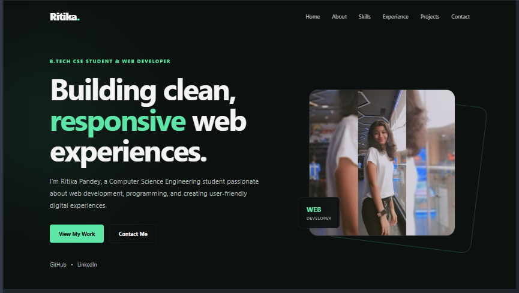
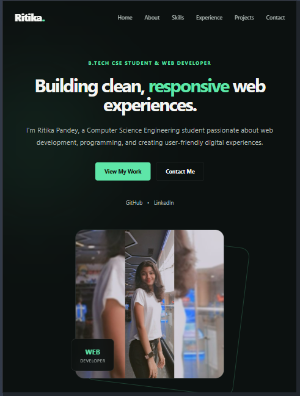
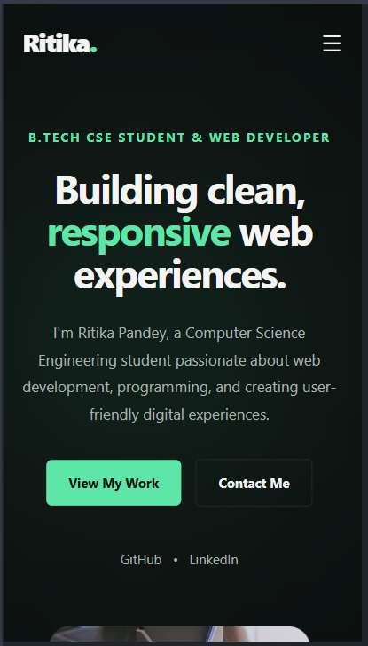

# CodeAlpha_Portfolio

## Personal Portfolio Website

A modern, responsive personal portfolio website developed as part of my **Frontend Development Internship at CodeAlpha**.

The website showcases my introduction, background, technical skills, web development projects, and contact information through a professional and interactive interface.

---

## ✨ Features

- Responsive design for desktop, tablet, and mobile devices
- Modern dark-themed user interface with purple accents
- Fixed navigation bar
- Responsive mobile navigation menu
- Active navigation link highlighting
- Home section with personal introduction
- About Me section
- Technical Skills section
- Projects showcase with GitHub links
- Resume download section
- Contact section
- Smooth scrolling
- Interactive hover effects
- Animated profile illustration area

---

## 🛠️ Technologies Used

- HTML5
- CSS3
- JavaScript
- Font Awesome
- Google Fonts (Poppins)
- Git and GitHub

---

## 📌 Website Sections

### Home
Introduction, professional headline, social media links, and navigation to the main sections of the portfolio.

### About Me
Information about my background, education, interests, and journey as a Computer Science Engineering student.

### Skills
An overview of my technical skills, including HTML, CSS, JavaScript, Java, Git & GitHub, and UI/UX Design.

### Projects
A showcase of my web development projects, including Image Gallery, Calculator, and Personal Portfolio Website.

### Resume
A section providing an option to download my resume.

### Contact
A contact section for professional communication and opportunities.

---

## 📱 Responsive Design

The website is designed to adapt to different screen sizes and provide a consistent user experience across:

- Desktop
- Tablet
- Mobile

---

## 🚀 Live Demo

[View Live Portfolio](https://ritika0117.github.io/CodeAlpha_Portfolio/)

---

## 📸 Responsive Design Preview

<table>
  <tr>
    <th>Desktop</th>
    <th>Tablet</th>
    <th>Mobile</th>
  </tr>
  <tr>
    <td></td>
    <td></td>
    <td></td>
  </tr>
</table>

---

## 📂 Project Structure

```text
CodeAlpha_Portfolio/
│
├── index.html
├── style.css
├── script.js
│
├── assets/
│   ├── profile.png
│   └── resume.pdf
│
├── Screenshots/
│   ├── desktop-portfolio.png
│   ├── tablet-portfolio.png
│   └── mobile-portfolio.png
│
└── README.md
```

---

## 💼 Internship Details

- **Organization:** CodeAlpha
- **Internship:** Frontend Development
- **Task:** Task 3 – Personal Portfolio Website

---

## 👩‍💻 Author

**Ritika Pandey**

- GitHub: [ritika0117](https://github.com/ritika0117)

---

Created with ❤️ as part of my frontend development learning journey.